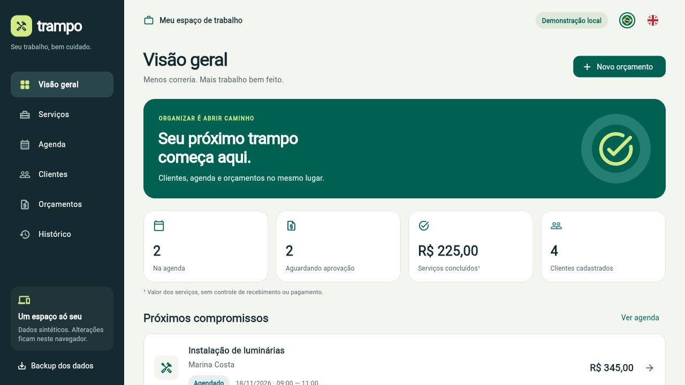
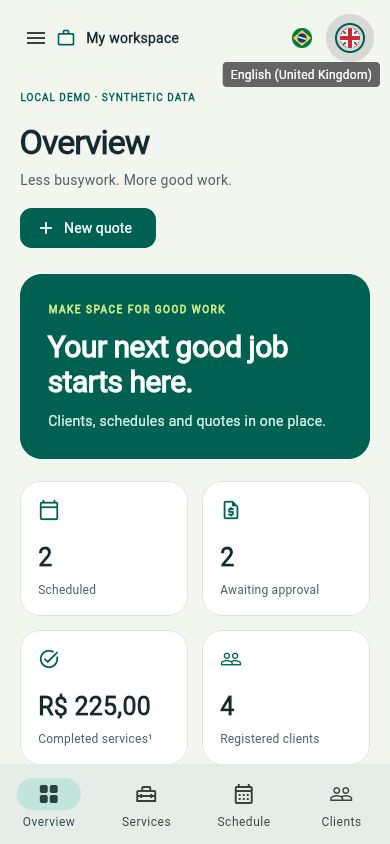

# Trampo

[](https://docs.flutter.dev/install/archive)
[](pubspec.yaml)
[](https://github.com/kleberandrade/trampo-flutter/actions/workflows/quality.yml)
[](LICENSE)

A thoughtful workspace for independent professionals managing small services. Keep clients, estimates, appointments, service status and history together. Created by **Kléber de Oliveira Andrade**.

The default application is an explicitly labeled **local demonstration with synthetic data**. It works without a Firebase account or credentials. Changes persist in the same browser and origin; Firebase is an optional, separate adapter, never a disguised local sign-in.

## Run it

Use **Flutter 3.50.0 / Dart 3.14.0**, pinned in `.fvmrc`. Install that release from the [official SDK archive](https://docs.flutter.dev/install/archive), then check `flutter --version`. If using FVM, prefix the Flutter commands below with `fvm`.

```sh
git clone https://github.com/kleberandrade/trampo-flutter.git
cd trampo-flutter
flutter --version
flutter pub get --enforce-lockfile
flutter run -d chrome --web-port 8768
```

The fixed port preserves the browser origin between launches. On first run, the app saves a synthetic workspace with three clients, two appointments, two quotes and one completed service. Appointment dates are relative to first launch; seed data is never regenerated over an existing workspace. Language defaults to PT-BR; use the circular Brazil/UK flags for English. The locale changes UI text and date formatting, while names, notes, money and history remain intact. Currency is always **BRL**, and money input always uses Brazilian notation, even in English.

For a static release preview:

```sh
flutter build web --release
python3 -m http.server 8768 --bind 127.0.0.1 --directory build/web
```

Open [the local preview](http://127.0.0.1:8768). This is a local server, not a deployment. A first Web load may require Flutter renderer assets; no installable-PWA/offline cold-start claim is made.

## What you can do

- **Clients:** create and edit names, phone numbers, addresses and notes. Delete only clients without current or historical service references.
- **Quotes:** record scope, labor, materials and discount, see the calculated total, and edit before work starts.
- **Approval and schedule:** record a manually agreed approval by scheduling the quote. Choose start/end dates and times. Reschedule before work starts; overlapping reservations for the single professional are blocked.
- **Services:** search by service/client/notes, filter statuses, start at or after the scheduled start, complete work, or cancel with confirmation.
- **History:** inspect timestamped creation, edits, scheduling and status changes. Entries retain the service title, total and client identity at the time of the event. Completed/cancelled services cannot be reopened, edited or silently deleted.
- **Backup:** open the navigation menu → Data backup → Copy JSON, and save the copied text in a safe file. Restore validates the snapshot before asking to replace local data. No cloud backup or automatic sync is implied.

For example: create a client, add a quote with labor `100,10`, materials `200,20` and discount `0,30`. The exact total is **R$ 300,00**. Open the service, approve and schedule it tomorrow, and try scheduling another service in the same interval: the app explains the conflict without losing either quote. A service ending at 11:00 permits the next one to begin at 11:00.

## Actual application screenshots



Desktop capture at 1280 × 720. This is the running application, not a design mockup.

 

Mobile viewport captures at 390 × 844. The captures include a fourth synthetic client added during the persistence check; first launch starts with three. These are browser viewport tests, not Android or iPhone device tests. Screenshot provenance is recorded in [validation](docs/VALIDATION.md).

## Domain rules

`quote → scheduled → active → completed`; a quote, scheduled service or active service may instead become `cancelled`. Scheduling is the only approval path. A scheduled quote remains editable; edits and rescheduling append history. Approval is an operator record of an agreement, not an electronic signature or a message to the client.

Amounts use integer cents with a maximum of R$ 9.999.999,99 per component and total. The calculation is `labor + materials − discount`; discounts cannot exceed the subtotal. Negative amounts, decimal points as a decimal separator and more than two decimal places are rejected. Quantities, taxes, invoices, receivables and payment processing are outside this version.

Appointments must start in the future, end later and last at most 24 hours. The schedule belongs to one professional; it is not a team allocation system. Conflict intervals are half-open `[start, end)`. Starting early is blocked; completed and cancelled records release the reservation. Overdue appointments remain visible for manual status updates. Dates are stored as UTC instants and displayed in the device timezone; changing timezone changes their displayed local time. No recurring appointments, timezone picker, calendar sync or notifications are provided.

## Architecture

- `lib/domain/workspace.dart`: immutable clients, jobs, budgets, history, money parsing and schedule/transition validation. Pure Dart rules.
- `lib/data/repository.dart`: replaceable `WorkspaceRepository` and a versioned `SharedPreferencesAsync` local snapshot.
- `lib/data/workspace_store.dart`: one writer per app instance; save first, publish UI state only after successful persistence. Previous data remains available on a failed write.
- `lib/data/firebase_repository.dart`: current Firebase Auth APIs and owner-scoped Firestore snapshots with optimistic revision checks. Not selected by `main.dart`.
- `lib/ui`: responsive navigation, editors, history/details, local flags and PT-BR/EN strings.

See [architecture and storage decisions](docs/ARCHITECTURE.md), [Firebase setup and verification](docs/FIREBASE.md), and [the concrete Portuguese lesson revision](docs/lesson-pt-br.md).

## Verify it

Run these in sequence, especially on a machine shared with other Flutter projects:

```sh
dart format --output=none --set-exit-if-changed lib test
flutter analyze --fatal-infos
flutter test --coverage
flutter build web --release
flutter pub outdated
```

The suite checks exact money arithmetic, scheduling boundaries, terminal states, backup integrity, historical client references, storage failures/reload, desktop/mobile workflows, and accessible names/touch targets/contrast with 150% text. The opt-in Firebase browser test is skipped in the normal suite. Its initialization timeout in this environment is documented; do not interpret a skipped test as a passing Firebase integration.

[Validation results and verified limits](docs/VALIDATION.md) distinguish passing local tests, passing emulator REST checks, the blocked FlutterFire browser test, and untested native platforms. The CI workflow runs the core checks; its badge reports the real GitHub result rather than a manually asserted status.

## Compatibility and limitations

All direct packages are current stable versions at the dependency audit: `material_ui 1.11.1`, `shared_preferences 2.5.6`, `firebase_core 5.2.0`, `firebase_auth 7.1.0`, `cloud_firestore 7.2.0`, `flutter_lints 6.0.0`. `pubspec.lock` records exact transitive versions. `material_color_utilities 0.13.0` and `test_api 0.7.14` remain SDK-constrained, despite newer catalog releases; no dependency overrides are used. See the [Flutter Material migration](https://docs.flutter.dev/release/breaking-changes/material-ui-and-cupertino-ui).

- **Web is the validated platform.** Android and iOS scaffolding has been regenerated with the original app identifier `com.kleberandrade.trampo` and original launcher artwork. Native compilation, signing and physical devices were not tested. Android minimum API 23; iOS minimum 15.0. Platform-specific Firebase setup is still required before enabling a real backend.
- **Local mode is a demonstration.** Browser preferences are not encrypted, transactional across tabs, or a production database. Use one tab per workspace; concurrent tabs can overwrite each other's saves. Browser cleanup, private browsing, origin/port changes or uninstalling can make local data unavailable. Keep a JSON backup.
- **History is application-level audit data**, not a tamper-proof ledger. Invalid references, transitions, totals, conflicting reservations and unsupported snapshot versions are rejected on restore; a fully rewritten internally consistent JSON file is not cryptographically authenticated.
- **Legacy data is not auto-migrated.** The original global `jobs` Firestore collection used `uid/name/description/price` and had no clients/schedule/history. Never copy it into the new owner-scoped schema without an explicit reviewed migration. No real legacy user data was read.
- No authentication screen is presented in local mode. Firebase account creation, login and password-reset APIs are retained as an isolated integration boundary, with no production backend deployed and no messages or emails sent.

## Contributing and credits

Read [CONTRIBUTING](CONTRIBUTING.md), [CHANGELOG](CHANGELOG.md) and [third-party notices](docs/THIRD_PARTY_NOTICES.md). Licensed under [MIT](LICENSE) for the repository owner's code; dependency licenses and original authorship remain intact.
