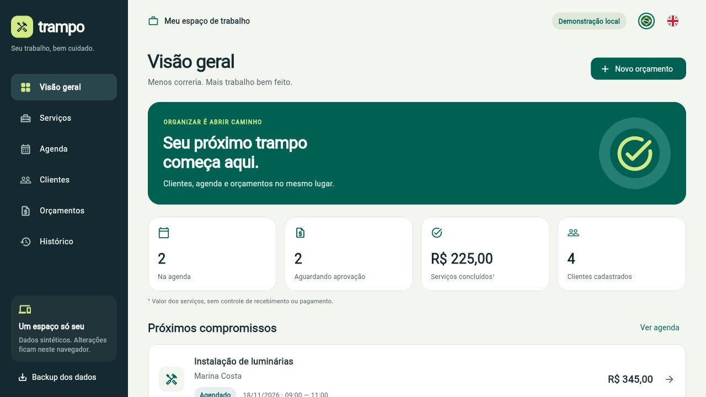

# Trampo com Flutter: do orçamento à entrega, com agenda e histórico

**Autor: Kléber de Oliveira Andrade.** Revisão preparada em 17 de novembro de 2026 para o projeto Trampo. Este arquivo é uma revisão didática concreta em português. Não é uma publicação no Medium. Nenhuma URL de aula vinculada foi identificada no repositório e não há acesso editorial conectado; uma eventual atualização deve preservar a URL, autoria e idioma da aula original após sua identificação. Não enviar newsletters.


A proposta continua simples: ajudar quem presta pequenos serviços a cuidar dos clientes, combinar valores, reservar horários e registrar entregas. Não construiremos um marketplace, nem uma plataforma de contratação ou pagamentos. Vamos transformar regras de trabalho em código verificável e oferecer uma demonstração que funciona sem credenciais externas.

## 1. Prepare uma execução reproduzível

Use Flutter **3.50.0**, com Dart **3.14.0**. O arquivo `.fvmrc` fixa a versão, e o lockfile registra as dependências resolvidas. A versão antiga exigia Dart 2.7 e utilizava APIs Firebase/MobX que não pertencem mais ao caminho de instalação atual; o manifesto histórico está em `pubspec-legacy.yaml` apenas para consulta.

```sh
git clone https://github.com/kleberandrade/trampo-flutter.git
cd trampo-flutter
flutter --version
flutter pub get --enforce-lockfile
flutter run -d chrome --web-port 8768
```

O comando de versão precisa mostrar Flutter 3.50.0/Dart 3.14.0. Se usar FVM, acrescente `fvm` antes de cada comando Flutter. Mantenha a porta: mudar de origem ou porta cria outro espaço de armazenamento no navegador.

As dependências diretas atuais incluem `material_ui 1.11.1`, `shared_preferences 2.5.6`, `firebase_core 5.2.0`, `firebase_auth 7.1.0` e `cloud_firestore 7.2.0`. A análise utiliza `flutter_lints 6.0.0`. O Flutter fixa duas transitivas em versões anteriores ao catálogo: `material_color_utilities 0.13.0` e `test_api 0.7.14`. Não force versões incompatíveis com overrides.

## 2. Explore o fluxo completo



A captura mostra o aplicativo executando, com dados sintéticos. A capa anterior é uma ilustração conceitual e não deve ser confundida com essa imagem.

Na primeira abertura, o aplicativo salva três clientes, dois serviços agendados, dois orçamentos e um serviço concluído. Os horários de exemplo são relativos à primeira execução. O conjunto não é recriado a cada abertura: alterações anteriores permanecem no mesmo navegador.

Cadastre um cliente e crie um orçamento. Informe nome do serviço, cliente, mão de obra, materiais, desconto e observações. Abra o orçamento para conferir o combinado. O botão **Aprovar e agendar** registra uma aprovação manual e reserva um intervalo; não envia mensagem ao cliente nem constitui assinatura eletrônica.

As telas de serviços, agenda, clientes, orçamentos e histórico mostram perspectivas diferentes do mesmo espaço de trabalho. No celular, as quatro rotas principais ficam na navegação inferior e as demais no menu. As bandeiras circulares Brasil/Reino Unido são desenhadas localmente, têm rótulo acessível, tooltip e área de toque de 48 pixels. Alterar o idioma não traduz ou apaga nomes, observações e histórico digitados.


Esta é uma verificação de viewport, não um teste em aparelho Android/iPhone. O quarto cliente desta captura foi criado durante o teste de persistência e reapareceu após recarregar a página.

## 3. Modele dinheiro antes de desenhar o formulário

Valores monetários são inteiros em centavos. A entrada segue a notação brasileira mesmo na interface em inglês: `100,10` representa 10.010 centavos; `100.10` não é aceito como decimal.

O exemplo abaixo corresponde à API presente em `lib/domain/workspace.dart` e aos testes de domínio:

```dart
final labor = Money.parse('100,10');
final materials = Money.parse('200,20');
final discount = Money.parse('0,30');
final budget = Budget(labor, materials, discount);

assert(budget.total == 30000);
assert(Money.format(budget.total) == r'R$ 300,00');
```

A conta é mão de obra mais materiais menos desconto. Não há arredondamento de porcentagem ou conversão de moeda. Valores negativos, mais de duas casas decimais e descontos maiores que o subtotal são rejeitados. Cada componente e o total têm limite de R$ 9.999.999,99. O número exibido de serviços concluídos soma valores dos serviços; ele não prova recebimento e não controla pagamentos.

## 4. Faça datas e transições expressarem o combinado

Um serviço nasce como orçamento. Agendar muda seu status para agendado. A partir do horário previsto, ele pode ser iniciado e, depois, concluído. Orçamentos e serviços agendados/em andamento podem ser cancelados; registros concluídos/cancelados são definitivos nesta versão.

O domínio concentra essas regras, sem depender de widgets ou do Firebase. Este trecho exercita a API real com datas explícitas e um relógio de teste:

```dart
final now = DateTime(2026, 11, 17, 12);
final start = DateTime(2026, 11, 18, 9);
var job = Job.create(
  id: 'example-job',
  clientId: 'example-client',
  title: 'Instalação de luminárias',
  budget: Budget(28000, 6500, 0),
  now: now,
);
job = job.schedule(
  start,
  start.add(const Duration(hours: 2)),
  [],
  now,
);
job = job.transition(JobStatus.active, start);
job = job.transition(
  JobStatus.completed,
  start.add(const Duration(hours: 2)),
);
assert(job.history.length == 4);
```

O relógio passado ao domínio torna o exemplo determinístico. Na interface, o relógio é o do dispositivo; tentar começar antes do agendamento mostra uma mensagem. Agendamentos precisam começar no futuro, terminar depois e durar no máximo 24 horas.

A agenda é de um profissional. Intervalos usam início inclusivo e fim exclusivo: um serviço de 9h a 11h permite outro às 11h; um começo às 10h30 conflita. Reagendar ignora a própria reserva, mas verifica todas as outras. Concluir/cancelar libera o intervalo. Serviços atrasados permanecem visíveis para atualização manual; o aplicativo não adivinha se o trabalho começou ou terminou.

As datas são serializadas em UTC e apresentadas no fuso do dispositivo. Viajar ou alterar o fuso muda a hora local mostrada. Não há recorrência, integração com calendários nem notificações nesta versão.

## 5. Grave primeiro e atualize a tela depois

`WorkspaceRepository` define `load()` e `save()`. A implementação local guarda um snapshot JSON versionado com clientes, serviços, eventos e idioma usando `SharedPreferencesAsync`. O store permite uma gravação por vez na instância, aguarda o salvamento e só então apresenta o novo estado.

Se a escrita falhar, a versão anterior continua disponível, e o formulário informa o problema para permitir nova tentativa. Se o conteúdo salvo estiver corrompido ou incompatível, a abertura mostra um estado de erro e não substitui os dados por exemplos. Estados vazios oferecem uma próxima ação útil, como criar um orçamento ou ajustar a busca.

O histórico acrescenta eventos de criação, edição, agendamento e mudança de status. Ele conserva título, valor e identidade do cliente daquele evento. Um cliente ligado a eventos anteriores não pode ser removido. Alterar o perfil de um cliente não cria versões históricas de seu nome/telefone; esse limite precisa permanecer explícito.

No menu, copie o backup JSON para um arquivo seguro. A restauração verifica formato, referências, totais, eventos e conflitos antes de confirmar a substituição. Isso não assina o conteúdo: um JSON inteiramente reescrito de forma consistente não é uma prova criptográfica de autoria.

Preferências do navegador não são um banco de produção, nem garantem transações entre abas. Use uma aba por espaço e mantenha backup. Limpeza do navegador, navegação privada ou mudança de origem podem tornar o conteúdo indisponível.

## 6. Separe demonstração e Firebase real

`main.dart` escolhe apenas o repositório local e exibe essa escolha. Não há usuário fictício autenticado. O adaptador separado usa as APIs atuais de Auth e Firestore, exige conta real e armazena um snapshot por proprietário em `users/{uid}/workspace/current`, com revisão otimista para detectar concorrência.

Para verificar o backend sem dados reais, inicie os emuladores do projeto `demo-trampo`. Com Node 24, Java 21+ e Python 3:

```sh
npx --yes firebase-tools@15.36.0 emulators:exec \
  --only auth,firestore --project demo-trampo --config firebase.json \
  "python3 tool/emulator_smoke.py"
```

O teste REST passou para cadastro/login sintéticos, persistência e rejeição de acesso anônimo/entre usuários, revisões incorretas, escritas desatualizadas e exclusão. Nenhum e-mail foi enviado. O teste opt-in do adaptador Flutter no Chrome compilou, mas teve um timeout de 20 segundos em `Firebase.initializeApp`, antes do acesso aos emuladores; a causa não foi confirmada. Isso não deve ser apresentado como integração FlutterFire integralmente validada.

As regras validam proprietário, estrutura básica do envelope e revisão; as regras de negócio completas ficam no Dart. Uma aplicação de produção precisa de uma estratégia adicional de validação, uma interface de conta e tratamento de conflitos, configuração própria e validação real de plataformas. Os antigos documentos globais `jobs` não são migrados automaticamente, e o campo numérico antigo `price` exige uma política de conversão explícita para centavos.

## 7. Verifique o que você pretende ensinar

Execute os checks em sequência:

```sh
dart format --output=none --set-exit-if-changed lib test
flutter analyze --fatal-infos
flutter test --coverage
flutter build web --release
flutter pub outdated
```

Os testes cobrem dinheiro, descontos, transições, conflitos, integridade do histórico, armazenamento, falhas e fluxos de interface. Também verificam rótulos acessíveis, áreas de toque, contraste e texto ampliado em 150%. A inspeção real foi feita no Web desktop e em viewport móvel; os projetos nativos foram atualizados, mas não compilados nem testados em aparelho. Nenhum backend ou aplicativo foi publicado.

## Referências e créditos

- [Código do Trampo e autoria de Kléber de Oliveira Andrade](https://github.com/kleberandrade/trampo-flutter).
- [Flutter 3.50: novidades oficiais](https://flutter.dev/blog/whats-new-in-flutter-3-50).
- [Migração oficial para Material e Cupertino separados](https://docs.flutter.dev/release/breaking-changes/material-ui-and-cupertino-ui).
- [shared_preferences: APIs e limites de persistência](https://pub.dev/packages/shared_preferences).
- [Configuração oficial Firebase para Flutter](https://firebase.google.com/docs/flutter/setup).
- [Emuladores Firebase](https://firebase.google.com/docs/emulator-suite).
- [Arquitetura](ARCHITECTURE.md), [validação e limites verificados](VALIDATION.md) e [licenças e créditos de terceiros](THIRD_PARTY_NOTICES.md).

A arte original do projeto foi preservada. A nova capa é uma ilustração vetorial conceitual; as demais imagens indicadas como capturas são do aplicativo executando com dados sintéticos. O repositório adota MIT para o código do proprietário, sem alterar licenças de dependências.

## Exercícios práticos

1. **Orçamento exato.** Objetivo: demonstrar precisão monetária. Cadastre mão de obra `100,10`, materiais `200,20` e desconto `0,30`. Critério de conclusão: a tela mostra R$ 300,00, a reabertura mantém esse total e um teste rejeita desconto superior ao subtotal.
2. **Agenda sem conflitos.** Objetivo: testar as bordas dos intervalos. Reserve 9h–11h e tente outro serviço às 10h30, depois às 11h. Critério de conclusão: o primeiro é bloqueado, o segundo é aceito e ambos os comportamentos estão cobertos por testes.
3. **Histórico e identidade.** Objetivo: preservar vínculos ao editar. Crie orçamento para um cliente e depois associe-o a outro. Critério de conclusão: os eventos anteriores mantêm a identidade original, o evento de edição aponta para o novo cliente e a exclusão de ambos é rejeitada enquanto houver referências.
4. **Persistência e recuperação.** Objetivo: verificar salvamento e tratamento de falhas. Crie um cliente sintético, altere o idioma, recarregue e faça backup. Critério de conclusão: os dados/idioma permanecem, um backup inválido é recusado sem alterar o estado e um teste simula falha de escrita preservando a versão anterior.
5. **Fronteira Firebase.** Objetivo: validar isolamento sem produção. Execute o smoke test nos emuladores e tente ler o snapshot com outro usuário sintético. Critério de conclusão: os checks REST passam e o acesso é negado; execute também o teste FlutterFire opt-in e registre honestamente sucesso ou o erro observado, sem chamar um timeout de aprovação.
